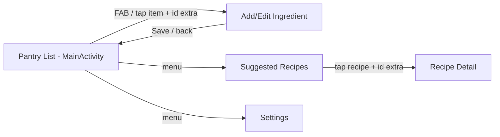
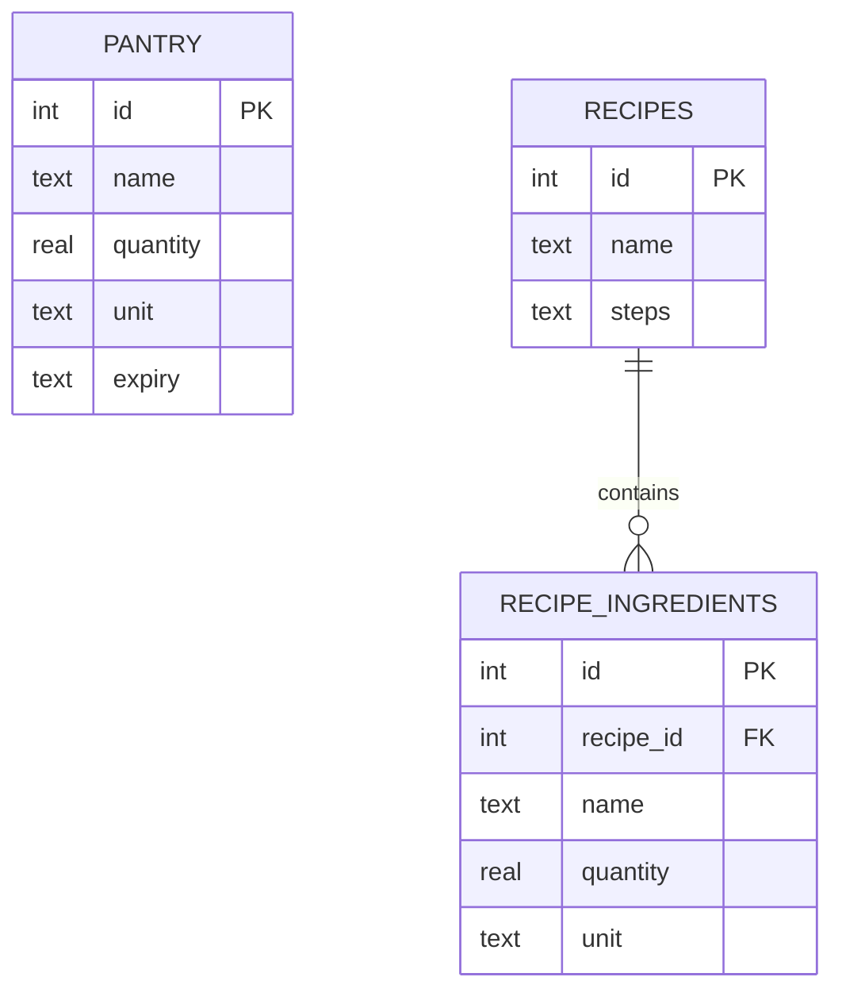

# Written report - structure and starter content

Follow the order in the brief. Times New Roman 12, 1.5 spacing, Harvard referencing (per the cover sheet).
Everything marked **[YOU]** must come from YOUR running app / YOUR experience.

## 1. Cover page  [YOU]
App name, name, student number, module (Mobile App Development 700), date.

## 2. Table of contents  (generate in Word: References > Table of Contents)

## 3. Introduction (starter)
Households throw away large amounts of edible food because people don't know what to cook with what is left.
Smart Pantry Manager lets a user record the ingredients they already own and suggests only the recipes they can
cook right now, with no shopping needed. It is aimed at students and families who want to save money and reduce waste.

## 4. System design
### Screen flow

(Redraw this neatly in draw.io / PowerPoint for the report.)

### Data model (ER)

PANTRY is independent: it is matched against recipes in code (RecipeMatcher), not by a foreign key.

## 5. Screenshots  [YOU - real screenshots only, each with a caption]
Checklist: empty pantry | pantry list | add form | validation errors (name + quantity) | date picker |
edit form pre-filled | delete confirmation | list after delete | suggested list (with matches) |
empty-suggestions message | "Almost There" list | recipe detail | settings | expiry banner.

## 6. Key code snippets (pick 3-5, explain what + why)
1. `RecipeMatcher.evaluate` - totals pantry quantities per normalised ingredient, then checks every required ingredient (the strict rule).
2. `IngredientNormalizer.normalize` - lower-case + simple singularisation so "Tomatoes" = "tomato".
3. `DatabaseHelper.onCreate` / `addItem` - table creation and parameterised CRUD.
4. `PantryAdapter.onBindViewHolder` - binding data to rows and handling clicks through a listener interface.
5. `AddEditItemActivity.saveItem` - validation before writing to the database.

## 7. Challenges and solutions  [YOU - use problems you REALLY hit]
Examples that commonly occur with this design (replace with your own if different):
- "tomato" vs "tomatoes" broke matching -> normaliser.
- "1 kg" vs "200 g" -> converted everything to a base unit.
- List did not update after editing -> moved the reload into `onResume`.
- Egg stored in grams matched a recipe needing 2 eggs -> separate count vs amount families.

## 8. Conclusion and reflection  [YOU]
What you learned (lifecycle, adapters, SQLite, testing) and what you'd improve (smarter name matching such as
"garlic cloves" = "garlic", shopping list, Room instead of raw SQLite, UI polish/dark mode, user-added recipes).

## 9. Reference list (Harvard) - verify each link and add YOUR access date
- Android Developers (n.d.) *Understand the Activity lifecycle*. Available at: https://developer.android.com/guide/components/activities/activity-lifecycle (Accessed: [date]).
- Android Developers (n.d.) *Create dynamic lists with RecyclerView*. Available at: https://developer.android.com/develop/ui/views/layout/recyclerview (Accessed: [date]).
- Android Developers (n.d.) *Intents and intent filters*. Available at: https://developer.android.com/guide/components/intents-filters (Accessed: [date]).
- Android Developers (n.d.) *SQLiteOpenHelper*. Available at: https://developer.android.com/reference/android/database/sqlite/SQLiteOpenHelper (Accessed: [date]).

Also include: working GitHub link, signed declaration of originality, and tick the instruction boxes on the cover sheet.
Final ZIP name: `Studentnumber_Surname_MobileAppDev700_Assignment.zip` (< 50 MB; exclude build/ and .gradle/).
